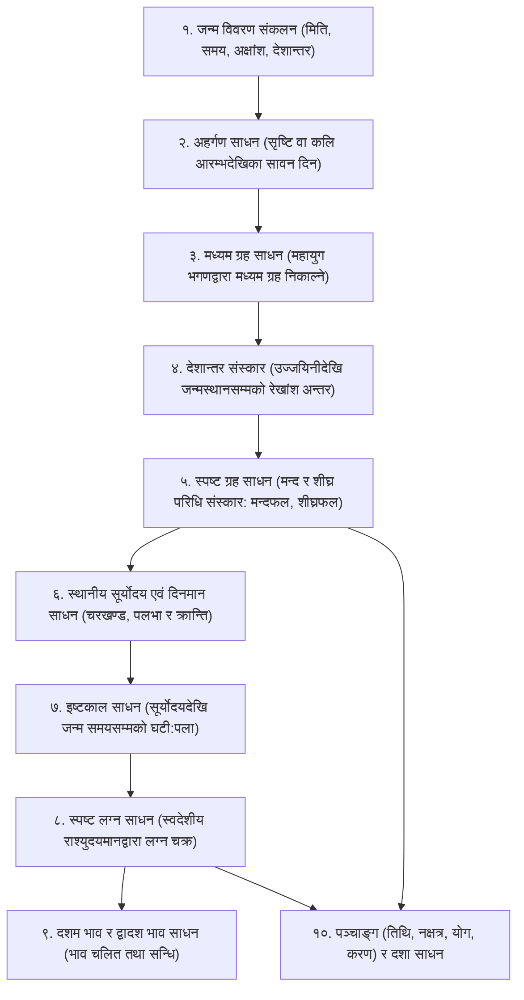

# ॥ सूर्य सिद्धान्त गणितीय पद्धति तथा कुण्डली गणना दिग्दर्शन ॥
### Complete Sequence and Methodology of Surya Siddhanta Astronomical & Astrological Calculations

---

## विषय-सूची (Table of Contents)
1. [सूर्य सिद्धान्तको परिचय एवं आधारभूत मान्यता](#१-सूर्य-सिद्धान्तको-परिचय-एवं-आधारभूत-मान्यता)
2. [गणनाको सम्पूर्ण क्रमबद्ध रूपरेखा (High-Level Calculation Workflow)](#२-गणनाको-सम्पूर्ण-क्रमबद्ध-रूपरेखा)
3. [प्रथम चरण: काल परिमाण एवं अहर्गण साधन (Elapsed Civil Days - Ahargana)](#३-प्रथम-चरण-काल-परिमाण-एवं-अहर्गण-साधन)
4. [दोस्रो चरण: मध्यम ग्रह साधन (Mean Planetary Longitudes)](#४-दोस्रो-चरण-मध्यम-ग्रह-साधन)
5. [तेस्रो चरण: देशान्तर संस्कार (Terrestrial Longitude Correction)](#५-तेस्रो-चरण-देशान्तर-संस्कार)
6. [चौथो चरण: स्पष्ट ग्रह साधन (True Planetary Longitudes & Epicycles)](#६-चौथो-चरण-स्पष्ट-ग्रह-साधन)
   - सूर्य र चन्द्रमाको मन्द संस्कार
   - ताराग्रहहरू (मङ्गल, बुध, गुरु, शुक्र, शनि) का चार संस्कारहरू
   - वक्री/मार्गी गति विचार
   - राहु र केतु (पात) साधन
7. [पाँचौँ चरण: क्रान्ति, चर, दिनमान र स्थानीय सूर्योदय साधन (Local Solar Events)](#७-पाँचौँ-चरण-क्रान्ति-चर-दिनमान-र-स्थानीय-सूर्योदय-साधन)
8. [छैटौँ चरण: इष्टकाल साधन (Local Sidereal Elapsed Time)](#८-छैटौँ-चरण-इष्टकाल-साधन)
9. [सातौँ चरण: स्पष्ट लग्न साधन (Ascendant / Lagna Sphuta)](#९-सातौँ-चरण-स्पष्ट-लग्न-साधन)
10. [आठौँ चरण: दशम भाव एवं द्वादश भाव साधन (House Cusps - Bhava Chalita)](#१०-आठौँ-चरण-दशम-भाव-एवं-द्वादश-भाव-साधन)
11. [नवौँ चरण: पञ्चाङ्ग साधन (Panchanga Calculations from Sun & Moon)](#११-नवौँ-चरण-पञ्चाङ्ग-साधन)
12. [दशौँ चरण: दशा साधन (Vimshottari, Tribhagi & Yogini Dashas)](#१२-दशौँ-चरण-दशा-साधन)
13. [आधुनिक सफ्टवेयरमा सूर्य सिद्धान्त कार्यान्वयन (Algorithm & Architecture)](#१३-आधुनिक-सफ्टवेयरमा-सूर्य-सिद्धान्त-कार्यान्वयन)

---

## १. सूर्य सिद्धान्तको परिचय एवं आधारभूत मान्यता

**सूर्य सिद्धान्त** वैदिक खगोल विज्ञान (Jyotish Siddhanta) को सबैभन्दा प्राचीन, प्रामाणिक र मान्य ग्रन्थ हो। यसमा भगवान् सूर्यले मय दानवलाई सत्ययुगको अन्त्यमा खगोलीय ग्रह-गति, काल-विभाजन, ग्रहण र कुण्डली निर्माणका नियमहरू उपदेश गर्नुभएको शास्त्रीय मान्यता छ।

### मूल आधारहरू:
1. **भूकेन्द्रीय प्रणाली (Geocentric Frame with Heliocentric Corrections):** पृथ्वीलाई केन्द्रमा मानेर ग्रहहरूको प्रत्यक्ष आकाश दर्शन (Geocentric coordinates) गरिन्छ, तर बुध र शुक्रको गतिको लागि सूर्यलाई केन्द्र बनाएर शीघ्र परिधिको नियम लागू गरिन्छ।
2. **स्थिर नक्षत्र चक्र (Nirayana System):** सूर्य सिद्धान्त निरयण (Sidereal) पद्धतिमा आधारित छ, जहाँ मेषादि बिन्दु रेवती पक्ष वा अश्विनी नक्षत्रको आरम्भबाट मानिन्छ।
3. **मध्यम रेखा (Prime Meridian):** लङ्का (विषुवत् रेखा र उज्जयिनी रेखांश जोडिने बिन्दु: ७५° ४६' पूर्वी देशान्तर) लाई विश्वको मानक शून्य रेखांश (Prime Meridian) मानिन्छ।

---

## २. गणनाको सम्पूर्ण क्रमबद्ध रूपरेखा

कुनै पनि व्यक्तिको जन्म मिति, समय र स्थानबाट सूर्य सिद्धान्त अनुसार पूर्ण कुण्डली तयार गर्दा निम्न **१० वटा क्रमबद्ध चरणहरू** पार गर्नुपर्छ:



---

## ३. प्रथम चरण: काल परिमाण एवं अहर्गण साधन

कुनै पनि दिनका ग्रहहरू पत्ता लगाउनको लागि समयको सुरूवातदेखि उक्त दिनसम्म बितेका कुल **सावन दिनहरू (Civil Days)** को गणना गरिन्छ, जसलाई **अहर्गण (Ahargana)** भनिन्छ।

### क. काल परिमाण नियम:
* १ कल्प = १४ मन्वन्तर = १,००० महायुग (चतुर्युग)
* १ महायुग = ४३,२०,००० सौर्य वर्ष
  * सत्ययुग = १७,२८,००० वर्ष (४ चरण)
  * त्रेतायुग = १२,९६,००० वर्ष (३ चरण)
  * द्वापरयुग = ८,६४,००० वर्ष (२ चरण)
  * कलियुग = ४,३२,००० वर्ष (१ चरण)
* **कलियुग आरम्भ:** ईसापूर्व ३१०२ फेब्रुअरी १८ (वि.सं. पूर्व ३१५६), शुक्रबारको मध्यरात (उज्जयिनी अर्धरात्रिक पद्धति) वा सूर्योदय।

### ख. अहर्गण निकाल्ने शास्त्रीय प्रक्रिया:
1. **सौर मास साधन:** बितेका कलि वर्षलाई १२ ले गुणन गरी चालू वर्षका बितेका महिना जोड्ने।
   $$\text{सौर मास} = (\text{कलिगत वर्ष} \times १२) + \text{बितेका महिना}$$
2. **अधिकमास साधन (Adhikamasa):**
   $$\text{अधिकमास} = \frac{\text{सौर मास} \times \text{महायुग अधिकमास}}{\text{महायुग सौर मास}}$$
   $$\text{चान्द्र मास} = \text{सौर मास} + \text{अधिकमास}$$
3. **तिथि साधन:**
   $$\text{चान्द्र तिथि} = (\text{चान्द्र मास} \times ३०) + \text{बितेका तिथिहरू}$$
4. **अवम दिन (क्षय तिथि - Tithi Kshaya) साधन:**
   $$\text{अवम दिन} = \frac{\text{चान्द्र तिथि} \times \text{महायुग अवम दिन}}{\text{महायुग चान्द्र तिथि}}$$
5. **अहर्गण (सावन दिन):**
   $$\mathbf{अहर्गण} = \text{चान्द्र तिथि} - \text{अवम दिन}$$

> **वार जाँच:** अहर्गणलाई ७ ले भाग गर्दा शेष ० आए शुक्रबार, १ आए शनिबार, २ आए आइतबार... यसरी बार मिल्नुपर्छ।

---

## ४. दोस्रो चरण: मध्यम ग्रह साधन (Mean Planetary Longitudes)

अहर्गण प्राप्त भएपछि १ महायुगमा ग्रहहरूले लगाउने कुल परिक्रमा (भगण - Revolutions) को आधारमा मध्यम ग्रह निकालिन्छ।

### महायुगमा ग्रहहरूको भगण तालिका (सूर्य सिद्धान्त अनुसार):
* **१ महायुगका सावन दिन:** १,५७,७९,१७,८२८ दिन
* **सौर वर्ष:** ४३,२०,०००

| ग्रह | महायुग भगण (Revolutions) | दैनिक मध्यम गति (लगभग) |
| :--- | :--- | :--- |
| **सूर्य** | ४३,२०,००० | ०° ५९' ०८" |
| **चन्द्रमा** | ५,७७,५३,३३६ | १३° १०' ३५" |
| **मङ्गल** | २२,९६,८३२ | ०° ३१' २६" |
| **बुध (शीघ्रोच्च)** | १,७९,३७,०६० | ४° ०५' ३२" |
| **गुरु** | ३,६४,२२० | ०° ०४' ५९" |
| **शुक्र (शीघ्रोच्च)** | ७०,२२,३७६ | १° ३६' ०८" |
| **शनि** | १,४६,५६८ | ०° ०२' ००" |
| **चन्द्र मन्दोच्च** | ४,८८,२०३ | ०° ०६' ४१" |
| **राहु (पातांश - वक्री)** | २,३२,२३८ | -०° ०३' ११" |

### मध्यम ग्रह निकाल्ने सूत्र:
$$\mathbf{मध्यम\ ग्रह\ (भगणांश)} = \frac{\text{अहर्गण} \times \text{ग्रहको महायुग भगण}}{\text{महायुग सावन दिन (१,५७,७९,१७,८२८)}}$$

यसरी आएको भागफलबाट पूर्ण परिक्रमा (३६०° का चक्रहरू) हटाएर बाँकी शेषलाई अंश, कला र विकलामा परिणत गरिन्छ। यो मान **लङ्का/उज्जयिनीको मध्यरात्रिकालीन वा सूर्योदयकालीन मध्यम ग्रह** हुन्छ।

---

## ५. तेस्रो चरण: देशान्तर संस्कार (Terrestrial Longitude Correction)

सूर्य सिद्धान्तको गणना लङ्का-उज्जयिनी मध्यरेखा (७५° ४६' पूर्व) का लागि हुन्छ। जन्मस्थान अन्यत्र भएमा देशान्तर संस्कार अनिवार्य हुन्छ।

1. **रेखांश अन्तर (Longitude Difference):**
   $$\Delta \lambda = \text{जन्मस्थानको देशान्तर} - ७५^\circ ४६'$$
2. **समय अन्तर (देशान्तर घटी):**
   $$\text{देशान्तर घटी} = \frac{\Delta \lambda \text{ (अंशमा)}}{६^\circ} \quad (\text{किनकि १ घटी} = ६^\circ, \text{ वा ४ मिनेट} = १^\circ)$$
3. **देशान्तर फल (Deshantara Phala):**
   $$\mathbf{देशान्तर\ फल} = \frac{\text{ग्रहको दैनिक गति} \times \Delta \lambda}{३६०^\circ}$$
   * यदि जन्मस्थान उज्जयिनीभन्दा **पूर्व** भएमा: मध्यम ग्रहमा देशान्तर फल **ऋण (-)** गरिन्छ।
   * यदि जन्मस्थान उज्जयिनीभन्दा **पश्चिम** भएमा: मध्यम ग्रहमा देशान्तर फल **धन (+)** गरिन्छ।

यसबाट **जन्मस्थानको मध्यम ग्रह** प्राप्त हुन्छ।

---

## ६. चौथो चरण: स्पष्ट ग्रह साधन (True Planetary Longitudes)

मध्यम ग्रहहरू समान गतिमा हिँड्ने काल्पनिक बिन्दु हुन्। आकाशमा देखिने वास्तविक ग्रह निकाल्न अण्डाकार कक्ष (Epicycle) अनुसार **मन्द फल** र **शीघ्र फल** संस्कार गरिन्छ।

### क. सूर्य र चन्द्रमाको स्पष्टीकरण (केवल मन्द संस्कार):
सूर्य र चन्द्रमामा पृथ्वीको कक्षाको केन्द्रबाट हुने अन्तरका कारण केवल एउटा **मन्द फल (Equation of Centre)** मात्र हुन्छ:
1. **मन्द केन्द्र (Manda Kendra):**
   $$\text{मन्द केन्द्र} = \text{मध्यम ग्रह} - \text{मन्दोच्च}$$
2. **मन्द परिधि (Epicycle Circumference):**
   * सूर्यको मन्द परिधि = १३° ४०' देखि १४° ००'
   * चन्द्रको मन्द परिधि = ३१° ४०' देखि ३२° ००'
3. **मन्द फल (Manda Phala):**
   $$\mathbf{\text{मन्द फल}} = \arcsin\left( \frac{\text{मन्द परिधि}}{३६०^\circ} \times \sin(\text{मन्द केन्द्र}) \right)$$
4. **स्पष्ट ग्रह:**
   * केन्द्र १ देखि ६ राशि (०°–१८०°) भएमा: $\text{स्पष्ट ग्रह} = \text{मध्यम ग्रह} - \text{मन्द फल}$
   * केन्द्र ७ देखि १२ राशि (१८०°–३६०°) भएमा: $\text{स्पष्ट ग्रह} = \text{मध्यम ग्रह} + \text{मन्द फल}$

---

### ख. पञ्चतारा ग्रहहरूको स्पष्टीकरण (मङ्गल, बुध, गुरु, शुक्र, शनि):
यी ग्रहहरूको कक्षा सूर्यको वरिपरि हुने भएकाले यिनमा **४ वटा संस्कारहरू** क्रमैसँग गरिन्छ:

```
[मध्यम ग्रह]
     │
     ▼
१. प्रथम शीघ्र संस्कार (अर्ध शीघ्र फल लागू गर्ने)
     │
     ▼
२. प्रथम मन्द संस्कार (अर्ध मन्द फल लागू गर्ने)
     │
     ▼
३. द्वितीय मन्द संस्कार (पूर्ण मन्द फल लागू गर्ने) ──> [मन्द स्पष्ट ग्रह]
     │
     ▼
४. द्वितीय शीघ्र संस्कार (पूर्ण शीघ्र फल लागू गर्ने) ──> [परम स्पष्ट ग्रह (True Longitude)]
```

#### ४ वटा संस्कारको विधि:
1. **शीघ्र केन्द्र १:** $\text{शीघ्र केन्द्र} = \text{शीघ्रोच्च} - \text{मध्यम ग्रह}$ (बुध र शुक्रको शीघ्रोच्च सूर्य हो; मङ्गल, गुरु, शनिको शीघ्रोच्च आफ्नै मध्यम सूर्य हो)।
   * यसबाट आउने शीघ्र फलको आधा भाग ($\frac{१}{२} \text{ शीघ्र फल}$) मध्यम ग्रहमा संस्कार गरिन्छ।
2. **मन्द केन्द्र १:** $\text{मन्द केन्द्र} = \text{संस्कृत मध्यम ग्रह} - \text{मन्दोच्च}$।
   * यसबाट आउने मन्द फलको आधा भाग ($\frac{१}{२} \text{ मन्द फल}$) मध्यम ग्रहमा संस्कार गरिन्छ।
3. **मन्द केन्द्र २:** $\text{मन्द केन्द्र} = \text{संस्कृत मध्यम ग्रह} - \text{मन्दोच्च}$।
   * यसबाट पूर्ण मन्द फल निकाली सुरुको मध्यम ग्रहमा जोड्ने/घटाउने गरिन्छ। यसलाई **मन्द स्पष्ट ग्रह** भनिन्छ।
4. **शीघ्र केन्द्र २:** $\text{शीघ्र केन्द्र} = \text{शीघ्रोच्च} - \text{मन्द स्पष्ट ग्रह}$।
   * यसबाट पूर्ण शीघ्र फल निकाली मन्द स्पष्ट ग्रहमा जोड्ने/घटाउने गरिन्छ।
   * अन्त्यमा प्राप्त हुने मान नै **स्पष्ट ग्रह (True Planetary Longitude)** हो।

---

### ग. वक्री, मार्गी र अस्त विचार:
* जब ताराग्रहहरूको शीघ्र केन्द्र निश्चित सीमामा पुग्छ (सूर्यको नजिक वा टाढा), तब ग्रह पृथ्वीबाट हेर्दा पछाडि फर्किएको देखिन्छ:
  * मङ्गल: शीघ्र केन्द्र १६४° देखि १९६° बीच हुँदा **वक्री**
  * गुरु: शीघ्र केन्द्र १३०° देखि २३०° बीच हुँदा **वक्री**
  * शनि: शीघ्र केन्द्र ११५° देखि २४५° बीच हुँदा **वक्री**
  * बुध: शीघ्र केन्द्र १४४° देखि २१६° बीच हुँदा **वक्री**
  * शुक्र: शीघ्र केन्द्र १६३° देखि १९७° बीच हुँदा **वक्री**
* **दैनिक स्पष्ट गति (Daily True Motion):** आजको स्पष्ट ग्रह र भोलिको स्पष्ट ग्रहको अन्तरबाट दैनिक गति निकालिन्छ। गति ऋणात्मक भए ग्रह **वक्री (Retrograde)** हुन्छ।

---

### घ. राहु र केतु (पात) साधन:
* राहु सधैँ वक्री गतिमा हिँड्ने बिन्दु हो।
  $$\text{राहु स्पष्ट} = ३६०^\circ - \text{मध्यम पातांश}$$
* केतु सधैँ राहुभन्दा ठीक १८०° विपरित हुन्छ:
  $$\text{केतु स्पष्ट} = (\text{राहु स्पष्ट} + १८०^\circ) \pmod{३६०^\circ}$$

---

## ७. पाँचौँ चरण: क्रान्ति, चर, दिनमान र स्थानीय सूर्योदय साधन

कुण्डली निर्माणको लागि स्थानीय सूर्योदय थाहा पाउनु अनिवार्य हुन्छ।

1. **सूर्यको सायन स्पष्ट (Sayana Sun):**
   $$\lambda_{\text{सायना}} = \text{स्पष्ट सूर्य} + \text{अयनांश}$$
   *(सूर्य सिद्धान्तमा दोलन अयनांश ±२७° को परिधिमा मानिन्छ)*
2. **सूर्यको क्रान्ति (Declination - $\delta$):**
   $$\sin(\delta) = \sin(\lambda_{\text{सायना}}) \times \sin(२४^\circ)$$
   *(२४° परम क्रान्ति मान)*
3. **पलभा (Equinoctial Shadow):**
   जन्मस्थानको अक्षांश ($\phi$) अनुसार १२ अङ्गुलको शङ्कुको विषुवत् छाया:
   $$\text{पलभा} = १२ \times \tan(\phi)$$
4. **चरखण्ड (Ascensional Difference - Chara):**
   $$\sin(\text{चर}) = \tan(\phi) \times \tan(\delta)$$
   यसलाई पलामा परिणत गर्दा चर पला प्राप्त हुन्छ।
5. **दिनमान र रात्रिमान:**
   * सूर्य उत्तर गोलार्धमा (उत्तरायण / $\delta > ०$): $\text{दिनमान} = ३० \text{ घटी} + (२ \times \text{चर घटी})$
   * सूर्य दक्षिण गोलार्धमा (दक्षिणायन / $\delta < ०$): $\text{दिनमान} = ३० \text{ घटी} - (२ \times \text{चर घटी})$
   * $\text{रात्रिमान} = ६० \text{ घटी} - \text{दिनमान}$
6. **स्थानीय सूर्योदय समय:**
   $$\text{स्थानीय सूर्योदय} = १२:०० - \frac{\text{दिनमान (घण्टामा)}}{२} \pm \text{स्थानीय समय सुधार}$$

---

## ८. छैटौँ चरण: इष्टकाल साधन (Local Elapsed Time)

बालक जन्मेको समय स्थानीय सूर्योदयभन्दा कति समय पछाडि हो, त्यसलाई घटी, पला र विपलामा निकाल्नुलाई **इष्टकाल** भनिन्छ।

$$\text{इष्ट समय (घण्टामा)} = \text{जन्म समय} - \text{स्थानीय सूर्योदय समय}$$
$$\mathbf{इष्टकाल\ (घटी:पला)} = \text{इष्ट समय (घण्टा)} \times २.५$$

*(१ घण्टा = २.५ घटी = १५० पला; १ घटी = ६० पला = २४ मिनेट; १ पला = ६० विपला = २४ सेकेन्ड)*

---

## ९. सातौँ चरण: स्पष्ट लग्न साधन (Ascendant / Lagna Sphuta)

लग्न भनेको जन्म समयमा पूर्वी क्षितिजमा उदाउँदै गरेको राशिको स्पष्ट अंश हो।

### क. स्वदेशीय राश्युदयमान (Local Sign Rising Times):
लङ्काको राश्युदयमान (निरक्ष उदयमान) मा जन्मस्थानको चरखण्ड जोडेर/घटाएर १२ वटै राशिका स्थानीय उदयमान (घटी-पलामा) निकालिन्छ:
* मेष, वृष, मिथुनमा चर घटाउने
* कर्कट, सिंह, कन्यामा चर जोड्ने
* तुला, वृश्चिक, धनुमा चर जोड्ने
* मकर, कुम्भ, मीनमा चर घटाउने

### ख. लग्न निकाल्ने चरणहरू:
1. **सूर्यको भुक्त र भोग्य काल:**
   * सूर्य जुन राशिमा छ, त्यस राशिको कति अंश बित्यो (भुक्त) र कति बाँकी छ (भोग्य) पत्ता लगाउने।
   $$\text{सूर्यको भोग्य पला} = \frac{(३०^\circ - \text{सूर्यको राश्यंश}) \times \text{उक्त राशिको उदयमान पला}}{३०^\circ}$$
2. यदि **इष्टकाल < सूर्यको भोग्य पला** भएमा:
   जन्म सूर्यकै राशिमा भयो (लग्न = सूर्यको राशि)।
3. यदि **इष्टकाल > सूर्यको भोग्य पला** भएमा:
   * इष्टकालबाट सूर्यको भोग्य पला घटाउने।
   * त्यसपछि आउने शेषबाट क्रमशः पछिल्ला राशिहरूको उदयमान घटाउँदै जाने, जबसम्म शेष घटाउन नसकिने गरी सानो हुँदैन।
   * जुन राशिको उदयमान घटाउन पुग्दैन, त्यही राशि **लग्न राशि** हुन्छ।
4. **लग्न स्पष्ट अंश निकाल्ने सूत्र:**
   $$\mathbf{\text{लग्न राश्यंश}} = \frac{\text{अवशिष्ट शेष पला} \times ३०^\circ}{\text{अशुद्ध (चालू) राशिको उदयमान पला}}$$

यसबाट **लग्न राशि, अंश, कला र विकला** स्पष्ट रूपमा प्राप्त हुन्छ।

---

## १०. आठौँ चरण: दशम भाव एवं द्वादश भाव साधन (House Cusps)

कुण्डलीका १२ वटा भावहरूको मध्य र सन्धि निकाल्न सूर्य सिद्धान्तमा **श्रीपति पद्धति** वा **चतुर्थ/दशम साधन** प्रयोग गरिन्छ:

1. **दशम लग्न (Medium Coeli / MC) साधन:**
   * जन्म समयको मध्याह्न रेखा (Meridian) मा रहेको राशिको अंश पत्ता लगाइन्छ, जसलाई दशम लग्न वा मध्यलग्न भनिन्छ।
2. **भाव सन्धि र भाव मध्य:**
   * लग्न (प्रथम भाव) र दशम भाव बीचको दूरीलाई ३ भागमा बाँडेर ११औँ र १२औँ भाव निकालिन्छ।
   * चतुर्थ भाव = दशम भाव + ६ राशि (१८०°)।
   * लग्न र चतुर्थ भाव बीचको दूरीलाई ३ भागमा बाँडेर २औँ र ३औँ भाव निकालिन्छ।
   * बाँकी भावहरू सममुख (विपरित १८०°) जोडेर १२ वटै भावका आरम्भ, मध्य र सन्धि स्पष्ट हुन्छन्।

---

## ११. नवौँ चरण: पञ्चाङ्ग साधन (Panchanga Calculations)

स्पष्ट सूर्य र चन्द्रमाको भोगांशबाट पञ्चाङ्गका पाँच अङ्गहरू तुरुन्तै निस्कन्छन्:

| पञ्चाङ्ग अङ्ग | गणितीय सूत्र | व्याख्या |
| :--- | :--- | :--- |
| **१. तिथि (Tithi)** | $$\text{तिथि} = \frac{\text{चन्द्र स्पष्ट} - \text{सूर्य स्पष्ट}}{१२^\circ}$$ | चन्द्र र सूर्यको अन्तर १२° बराबर १ तिथि हुन्छ। १ देखि १५ शुक्ल, १६ देखि ३० कृष्ण। |
| **२. नक्षत्र (Nakshatra)** | $$\text{नक्षत्र} = \frac{\text{चन्द्र स्पष्ट}}{१३^\circ २०'}$$ | कुल ३६०° लाई २७ नक्षत्रले भाग गर्दा १ नक्षत्र = १३° २०' (८०० कला) हुन्छ। |
| **३. योग (Yoga)** | $$\text{योग} = \frac{\text{सूर्य स्पष्ट} + \text{चन्द्र स्पष्ट}}{१३^\circ २०'}$$ | सूर्य र चन्द्रको भोगांशको योगफललाई १३° २०' ले भाग गर्दा २७ योग निस्कन्छ। |
| **४. करण (Karana)** | $$\text{करण} = \frac{\text{चन्द्र स्पष्ट} - \text{सूर्य स्पष्ट}}{६^\circ}$$ | तिथिको आधा भाग (६°) बराबर १ करण हुन्छ (कुल ६० करण)। |
| **५. वार (Vaara)** | $$\text{वार} = (\text{अहर्गण} + १) \pmod ७$$ | अहर्गणबाट सिधै ७ ले भाग गर्दा आउने बार। |

* **नक्षत्र पाउ (Pada):** नक्षत्रको बितेको भागलाई $३^\circ २०'$ (२०० कला) ले भाग गर्दा १ देखि ४ पाउ र सोही अनुसार **नामाक्षर** प्राप्त हुन्छ।

---

## १२. दशौँ चरण: दशा साधन (Dasha Computations)

चन्द्रमाको नक्षत्र भोगांशबाट जन्मकालीन **भोग्य दशा** निकालिन्छ।

1. **भुक्त कला (Elapsed Nakshatra Minutes):**
   $$\text{भुक्त कला} = \text{चन्द्रमाको नक्षत्रभित्रको भोगांश (कलामा)}$$
2. **भोग्य कला (Remaining Nakshatra Minutes):**
   $$\text{भोग्य कला} = ८००' - \text{भुक्त कला}$$
3. **विंशोत्तरी दशा (Vimshottari Dasha - १२० वर्ष चक्र):**
   * जन्म नक्षत्रको स्वामी ग्रहको कुल दशा वर्ष $D_{\text{total}}$ भएमा:
   $$\mathbf{\text{जन्मकालीन भोग्य दशा वर्ष}} = \frac{\text{भोग्य कला} \times D_{\text{total}}}{८००'}$$
   * यसलाई वर्ष, महिना र दिनमा रूपान्तरण गरी जन्म मितिमा जोड्दै सम्पूर्ण महादशा र अन्तर्दशाको समय तालिका तयार गरिन्छ।
4. **त्रिभागी दशा (Tribhagi - ८० वर्ष चक्र) र योगिनी दशा (३६ वर्ष चक्र):**
   * त्रिभागीमा दशा वर्षलाई $\frac{२}{३}$ अनुपातमा र योगिनीमा सम्बन्धित योगिनीको वर्ष (१ देखि ८ वर्ष) अनुसार सोही भोग्य अनुपात प्रयोग गरिन्छ।

---

## १३. आधुनिक सफ्टवेयरमा सूर्य सिद्धान्त कार्यान्वयन (Algorithm & Architecture)

हाम्रो प्रणालीमा सूर्य सिद्धान्तको गणनालाई आधुनिक जाभास्क्रिप्ट/पाइथन इन्जिनमा यसरी व्यवस्थित गरिएको छ:

```
[UI Input Form: मिति, समय, पाँचथर (27.2° N, 87.8° E)]
                      │
                      ▼
       [astrology.js / ephemeris.js]
  1. convertDateToJulianDay(bsYear, bsMonth, bsDay, time)
  2. getSuryaSiddhantaAhargana() -> अहर्गण प्राप्त
  3. computeMeanPlanets() -> ९ वटै ग्रहको मध्यम गति र भोगांश
  4. applyDeshantaraCorrection(lonDiffFromUjjain)
  5. applyMandaAndShighraCorrections() -> १०८ युक्ताक्षर एवं स्पष्ट ग्रह
  6. calculateSunriseAndChara(lat, declination) -> स्थानीय सूर्योदय
  7. calculateIshtakala(birthTime, sunriseTime) -> इष्ट घटी:पला
  8. calculateLagnaSphuta(ishtaGhati, localSignAscensions) -> लग्न चक्र
  9. generateShodashavarga(D1 to D60) -> १६ वटा वर्ग कुण्डलीहरू
 10. computeDashas(Vimshottari, Tribhagi, Yogini) -> ३x३ ग्रिड तालिका
 11. matchBPHSPhaladesh(dashaLords, houses) -> बृहत पाराशर श्लोक तथा नेपाली फल
                      │
                      ▼
[Full Report / Single-Page Patrika SVG & Print Engine]
```

---

## निष्कर्ष (Summary)

सूर्य सिद्धान्त केवल ग्रहको स्थिति निकाल्ने साधारण क्यालेन्डर नभई **सृष्टिको आरम्भदेखिको अखण्ड समय प्रवाहलाई स्थानीय क्षितिज र अण्डाकार कक्षीय सिद्धान्त (Epicycles) सँग समन्वय गर्ने पूर्ण खगोलीय विज्ञान** हो। यस दस्तावेजमा उल्लिखित क्रमबद्ध सूत्रहरू नै नेपाली परम्परागत पञ्चाङ्ग, चीना र कुण्डली निर्माणका सनातन आधारशिला हुन्।
