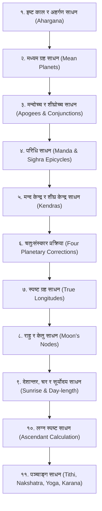

# वेदश्चक्षु: सूर्य सिद्धान्त (Surya Siddhanta - Classical) गणना पद्धति

यो दस्तावेज यस सफ्टवेयर (`SKY VISION 2.0`) भित्र समाविष्ट **प्राचीन वैदिक सूर्य सिद्धान्त** को सम्पूर्ण गणना, क्रम, प्रक्रिया र गणितीय विन्दुहरूको प्रामाणिक विवरण हो। यस फोल्डरमा सूर्यसिद्धान्तसँग सम्बन्धित मूल कम्पोनेन्टहरू [`Astro_function.dll`](file:///c:/Users/Hp%20Victus/Documents/aiclass/skyvision/वेदश्चक्षु/Astro_function.dll) र [`miti.dll`](file:///c:/Users/Hp%20Victus/Documents/aiclass/skyvision/miti.dll) सुरक्षित गरिएका छन्।

---

## १. सैद्धान्तिक परिचय तथा सफ्टवेयर आर्किटेक्चर

सूर्य सिद्धान्त भारतीय तथा नेपाली परम्परागत ज्योतिषीय खगोलशास्त्रको मूल ग्रन्थ हो। यस सफ्टवेयरमा सूर्यसिद्धान्तीय गणनाका लागि विशेष गरी निम्न मोड्युल र प्रकार्यहरू (Functions) निर्माण गरिएका छन्:
* **`Aahargan` (अहर्गण):** सृष्टि वा कल्प/कलियुग आरम्भदेखि अभीष्ट दिनसम्म बितेका सावन दिनहरूको योग।
* **`suryasiddhanta` (सूर्यसिद्धान्त मुख्य इन्जिन):** मध्यम ग्रह, मन्दोच्‍च, शीघ्रोच्‍च र परिधि गणना।
* **परिधि चतुष्टय (`prathamParidhi`, `divityaParidhi`, `trityaParidhi`, `chaturthaParidhi`):** ग्रहहरूको मन्द र शीघ्र वृत्तीय परिधि (Epicycles)।
* **`pltRahu_Suryasiddhanta`:** सूर्यसिद्धान्तीय नियम अनुसार राहु-केतुको विलोम गति स्पष्टीकरण।
* **`miti_change` / `Barsha` ([`miti.dll`](file:///c:/Users/Hp%20Victus/Documents/aiclass/skyvision/वेदश्चक्षु/miti.dll)):** विक्रम संवत्, शक संवत्, मास, पक्ष र तिथिको क्यालेन्डर समन्वय।

---

## २. सूर्यसिद्धान्तीय गणनाको वैज्ञानिक क्रम (Sequence of Calculation)

सूर्यसिद्धान्त अनुसार ग्रह स्पष्ट गर्ने प्रक्रिया निम्न ११ क्रमिक चरणहरूमा सम्पन्न हुन्छ:

---

## ३. विस्तृत प्रक्रिया तथा गणितीय सूत्रहरू (Mathematical Formulas)

### चरण १: अहर्गण साधन (Ahargana Calculation)
अहर्गण भन्नाले कुनै निश्चित आधार विन्दु (युगादि वा कल्पादि) देखि इष्ट दिनसम्मको जम्मा सावन दिनको सङ्ख्या हो।
* **सौर वर्ष $\rightarrow$ सौर मास:** 
  $$\text{सौर मास} = (\text{विगत सौर वर्ष} \times 12) + \text{विगत चान्द्र मास}$$
* **अधिमास (Intercalary Months) साधन:**
  $$\text{अधिमास} = \frac{\text{सौर मास} \times \text{युग अधिमास}}{\text{युग सौर मास}}$$
* **चान्द्र दिन (Tithis):**
  $$\text{चान्द्र दिन} = (\text{सौर मास} + \text{अधिमास}) \times 30 + \text{इष्ट तिथि}$$
* **अवम दिन (Omitted Tithis / क्षय तिथि):**
  $$\text{अवम दिन} = \frac{\text{चान्द्र दिन} \times \text{युग क्षय दिन}}{\text{युग चान्द्र दिन}}$$
* **शुद्ध अहर्गण (Ahargana):**
  $$\text{अहर्गण } (A) = \text{चान्द्र दिन} - \text{अवम दिन}$$

---

### चरण २: मध्यम ग्रह साधन (Mean Longitude)
महायुगमा हुने ग्रहको पूर्ण भगण (Revolutions) र महायुगको सावन दिनको अनुपातबाट मध्यम ग्रह निकालिन्छ:
$$\text{मध्यम ग्रह} = \frac{A \times \text{महायुग भगण}}{\text{महायुग सावन दिन}} \times 360^\circ \pmod{360^\circ}$$
* **महायुग सावन दिन:** $1,577,917,828$ दिन
* **ग्रहहरूको महायुग भगण (सूर्य सिद्धान्त):**
  * सूर्य, बुध शीघ्र, शुक्र शीघ्र: $4,320,000$
  * चन्द्रमा: $57,753,336$
  * मङ्गल: $2,296,832$
  * बृहस्पति: $364,220$
  * शनि: $146,568$
  * चन्द्र उच्च (मन्दोच्‍च): $488,203$
  * चन्द्र पातः (राहु - विलोम): $232,238$

---

### चरण ३ & ४: मन्द र शीघ्र परिधि (Epicycles of Correction)
सूर्यसिद्धान्तमा ग्रहको कक्षीय विषमतालाई मिलाउन **मन्द परिधि ($\Pi_m$)** र **शीघ्र परिधि ($\Pi_s$)** प्रयोग गरिन्छ:
* **सम र विषम पद संस्कार:**
  युग्म (Even: २, ४) पद र ओज (Odd: १, ३) पद अनुसार परिधिको मान फरक हुन्छ:
  $$\Pi_{\text{स्फुट}} = \Pi_{\text{विषम}} \pm \left( (\Pi_{\text{सम}} - \Pi_{\text{विषम}}) \times \frac{|\sin(\text{केन्द्र})|}{R} \right)$$
* सफ्टवेयरमा रहेका चार परिधिहरू:
  1. `prathamParidhi`: प्रथम शीघ्र परिधि
  2. `divityaParidhi`: द्वितीय मन्द परिधि
  3. `trityaParidhi`: तृतीय मन्द परिधि
  4. `chaturthaParidhi`: चतुर्थ शीघ्र परिधि

---

### चरण ५ & ६: मन्दफल र शीघ्रफल ज्या (Equation of Centre & Conjunction)
* **मन्द केन्द्र (Manda Kendra):**
  $$\theta_m = \text{मध्यम ग्रह} - \text{मन्दोच्‍च}$$
* **मन्दफल ज्या (Manda Correction):**
  $$\sin(\Delta \lambda_m) = \frac{\Pi_m \times \sin(\theta_m)}{360^\circ}$$
* **शीघ्र केन्द्र (Sighra Kendra):**
  $$\theta_s = \text{शीघ्रोच्‍च} - \text{ग्रह}$$
* **शीघ्रफल ज्या (Sighra Correction):**
  $$\tan(\Delta \lambda_s) = \frac{\Pi_s \sin(\theta_s)}{360^\circ + \Pi_s \cos(\theta_s)}$$

---

### चरण ७: पञ्चतारा ग्रहको चतुःसंस्कार प्रक्रिया (Four-Step Correction)
भौम (मङ्गल), बुध, गुरु, शुक्र र शनिका लागि सूर्यसिद्धान्तको शास्त्रीय चतुःसंस्कार विधि:
1. **प्रथम संस्कार:** मध्यम ग्रहबाट शीघ्र केन्द्र निकाली शीघ्रफलको आधा ($\frac{1}{2} \Delta \lambda_{s1}$) मध्यम मन्दोच्‍चमा जोड्ने/घटाउने।
2. **द्वितीय संस्कार:** त्यसबाट मन्दफल निकाली त्यसको आधा ($\frac{1}{2} \Delta \lambda_{m1}$) मध्यम ग्रहमा संस्कार गर्ने।
3. **तृतीय संस्कार:** सो संशोधित ग्रहबाट पुनः पूर्ण मन्दफल ($\Delta \lambda_{m2}$) निकाली मूल मध्यम ग्रहमा संस्कार गर्ने $\rightarrow$ **मन्द स्पष्ट ग्रह**।
4. **चतुर्थ संस्कार:** मन्द स्पष्ट ग्रहबाट पुनः पूर्ण शीघ्रफल ($\Delta \lambda_{s2}$) निकाली संस्कार गर्ने $\rightarrow$ **परम स्पष्ट ग्रह (True Planet)**।

---

### चरण ८: राहु र केतु साधन
* राहु सधैँ विलोम (Retrograde) गतिमा रहने हुँदा यसको गति उल्टो दिशाबाट घटाइन्छ:
  $$\text{राहु स्पष्ट} = 360^\circ - \left( \frac{A \times \text{पात भगण}}{\text{महायुग दिन}} \times 360^\circ \right) \pmod{360^\circ}$$
* **केतु स्पष्ट:**
  $$\text{केतु स्पष्ट} = (\text{राहु स्पष्ट} + 180^\circ) \pmod{360^\circ}$$

---

### चरण ९: देशान्तर, चर, दिनमान र सूर्योदय साधन
* **देशान्तर संस्कार:** उज्जैन (वा लङ्का) को प्रधान याम्योत्तर रेखा र स्थानीय रेखांशको अन्तर:
  $$\Delta t_{\text{देशान्तर}} = \frac{|\text{स्थानीय देशान्तर} - \text{उज्जैन देशान्तर}| \times 60}{360^\circ} \text{ (घटी-पलामा)}$$
* **सूर्यको क्रान्ति (Declination $\delta$):**
  $$\sin \delta = \sin(\text{सायन सूर्य}) \times \sin(24^\circ)$$
* **चर (Ascensional Difference $\Delta \alpha$):**
  $$\sin(\text{चर}) = \tan(\delta) \times \tan(\phi) \quad (\phi = \text{स्थानीय अक्षांश})$$
* **दिनमान (Day Duration):**
  $$\text{दिनमान} = 30 \pm 2 \times \text{चर (घटीमा)}$$
* **स्थानीय सूर्योदय:**
  $$\text{सूर्योदय} = 30 - \frac{\text{दिनमान}}{2} \text{ घटी}$$

---

### चरण १०: स्पष्ट लग्न साधन (Ascendant / Lagna)
* **इष्टकाल:** जन्म समय र सूर्योदय बीचको समय (घटी, पला, विपलामा)।
* **सायन सूर्यको भुक्त/भोग्य काल:** 
  सूर्य जुन राशिमा छ, त्यस राशिको बाँकी अंशलाई स्थानीय राश्युदयमानले गुणन गरी भुक्त घटी निकालिन्छ।
* **लग्न चक्र:** इष्ट घटीबाट भुक्त घटी घटाउँदै जाँदा शेष घटीलाई सम्बन्धित राश्युदयमानले भाग गरी स्पष्ट लग्न (राशि, अंश, कला, विकला) निकालिन्छ।
* **निरयण लग्न:**
  $$\text{निरयण लग्न} = (\text{सायन लग्न} - \text{अयनांश}) \pmod{360^\circ}$$

---

### चरण ११: दैनिक पञ्चाङ्ग साधन
1. **तिथि (Tithi):**
   $$\text{तिथि} = \frac{\text{स्पष्ट चन्द्र} - \text{स्पष्ट सूर्य}}{12^\circ}$$
2. **नक्षत्र (Nakshatra):**
   $$\text{नक्षत्र} = \frac{\text{स्पष्ट चन्द्र}}{13^\circ 20'}$$
3. **योग (Yoga):**
   $$\text{योग} = \frac{\text{स्पष्ट सूर्य} + \text{स्पष्ट चन्द्र}}{13^\circ 20'}$$
4. **करण (Karana):**
   $$\text{करण} = \frac{\text{स्पष्ट चन्द्र} - \text{स्पष्ट सूर्य}}{6^\circ}$$
